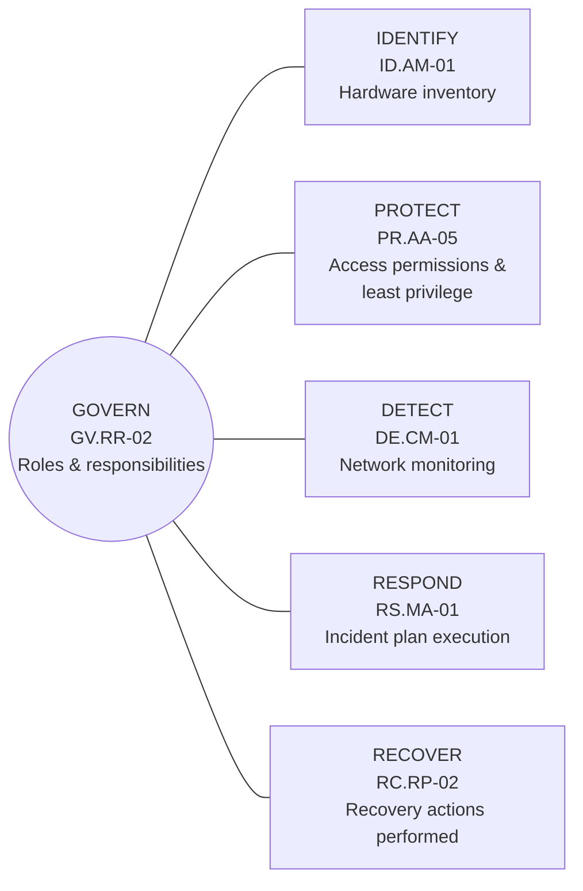

# NIST CSF 2.0 GRC Assessment: Fictional MSP

A hands-on governance, risk, and compliance (GRC) case study. It assesses **Summit Technology Solutions**, a *fictional* managed service provider (MSP) in Denver, against selected outcomes of the **NIST Cybersecurity Framework (CSF) 2.0**. The work runs end to end: scoping and evidence review, Current and Target Profiles, risk assessment, gap tracking, a remediation roadmap, and executive reporting.

> **Disclaimer:** All organization names, interviews, records, findings, metrics, and management decisions are fictional. This is an educational simulation. It is **not** an independent audit, formal attestation, certification, or claim of NIST compliance. NIST does not certify organizations to CSF 2.0.

---

## Business scenario

| Attribute | Detail |
|---|---|
| Organization | Summit Technology Solutions (fictional MSP) |
| Size | About 150 employees, 75 clients |
| Technology | Microsoft 365, Azure, ConnectWise, endpoint protection, security monitoring (SIEM) |
| Assessment scope | Summit's **internal MSP security operations** and shared administrative infrastructure |
| Out of scope | Audits of each of the 75 client environments |
| Assessment date | October 2026 |

**Why an MSP?** MSPs hold privileged, shared access to many client environments. One weakness in the MSP's own administration, such as an unmanaged privileged account in the remote monitoring and management (RMM) tool, can spread to every client. That makes the MSP's internal security operations the right place to start.

## Scope: one outcome per CSF function

The assessment covers **six selected CSF 2.0 outcomes**, one from each function. It does not cover the full CSF Core.

## Headline results

### Current Profile

| Outcome | Function | Current rating | Priority | Key condition |
|---|---|---|:---:|---|
| GV.RR-02 | Govern | Partially achieved | Moderate | Security responsibilities exist informally; approved accountability is not documented |
| ID.AM-01 | Identify | Partially achieved | High | ConnectWise (420) and Defender (455) records are unreconciled; 18 unowned, 12 stale, 8 lifecycle mismatches |
| PR.AA-05 | Protect | Partially achieved | High | Two problematic privileged accounts contained; recurring access reviews not yet proven |
| DE.CM-01 | Detect | Partially achieved | Moderate | SIEM is operational, but coverage and alert effectiveness are not validated |
| RS.MA-01 | Respond | Partially achieved | High | Incident response plan exists; no exercise evidence |
| RC.RP-02 | Recover | **Not verified** | **Critical** | Backup jobs run, but there is no evidence of restore testing |

**Summary:** 0 Achieved, 5 Partially achieved, 0 Not achieved, 1 Not verified.

### Gaps and risks

| Gap | Outcome | Gap | Linked risk | Inherent risk (L × I) | Owner |
|---|---|---|---|:---:|---|
| GAP-001 | PR.AA-05 | Privileged access governance | RISK-001 | **Critical (20)** → High (10) after containment | IT Director |
| GAP-002 | ID.AM-01 | Inventory reconciliation | RISK-002 | High (12) | IT Operations Manager |
| GAP-003 | RC.RP-02 | Recovery test evidence | RISK-003 | **Critical (20)**, provisional | Infrastructure Manager |
| GAP-004 | RS.MA-01 | Incident response exercise | RISK-004 | High (12), provisional | Security Manager |
| GAP-005 | DE.CM-01 | Network monitoring validation | RISK-005 | Moderate (9), provisional | Security Manager |
| GAP-006 | GV.RR-02 | Formal security responsibilities | RISK-006 | Moderate (6), provisional | CEO / IT Director |

### Key findings

- **Privileged access (GAP-001).** 24 privileged accounts were found, 22 with MFA. Two were unmanaged: a legacy service account with interactive access (ADMIN-023) and a former contractor's account (ADMIN-024). Both had privileged RMM access and no MFA. Authorized containment disabled both, revoked sessions, and enforced MFA on the remaining interactive privileged accounts. This lowered the risk from **Critical (20) to High (10)**. Recurring reviews and alerting still need to be tested.
- **Inventory (GAP-002).** ConnectWise shows 420 devices and Defender shows 455. **The difference does not prove that 35 devices are missing.** Scope, duplicates, and lifecycle status must be reconciled first.
- **Recovery (GAP-003).** Backups are reported as running, but no restore test results exist. Recovery capability cannot be confirmed. This is rated Critical until it is tested.
- **Response and monitoring (GAP-004, GAP-005).** The incident plan has never been exercised, and SIEM coverage has not been validated through alert testing.
- **Governance (GAP-006).** Security responsibilities are understood informally but are not documented, approved, or communicated.

## Assessment workflow

1. **Scope:** set boundaries, objectives, and stakeholders.
2. **Evidence:** review simulated evidence against the six selected outcomes.
3. **Rate:** classify each outcome as *Achieved*, *Partially achieved*, *Not achieved*, or *Not verified* using a **project-defined** rubric. These are not NIST-issued scores.
4. **Profile:** document the current state, its limitations, and measurable target outcomes.
5. **Risk:** score risks on an illustrative 5×5 likelihood × impact matrix. Keep **preliminary** risk separate from **validated** residual risk.
6. **Remediate:** assign owners, testing criteria, due dates, and a reporting cadence.

### Risk rating bands

| Score (L × I) | Rating |
|:---:|---|
| 1–4 | Low |
| 5–9 | Moderate |
| 10–19 | High |
| 20–25 | Critical |

## Evidence traceability

Every gap traces back to specific evidence items. That way each conclusion can be checked, and its limitations are on record.

| Evidence ID | Domain | Status | Supports | Limitation |
|---|---|---|---|---|
| IAM-001 | Privileged access | Reviewed | GAP-001 | Initial finding |
| IAM-002 | Privileged access | Reviewed | GAP-001 | No breach established |
| IAM-003 | Privileged access | Reviewed | GAP-001 | Ongoing control validation open |
| AST-001 | Asset inventory | Reviewed | GAP-002 | Different populations possible |
| AST-002 | Asset ownership | Reviewed | GAP-002 | Overlap with other exceptions unknown |
| AST-003 | Asset lifecycle | Reviewed | GAP-002 | Reconciliation SOP absent |
| IR-001 | Incident response | Partial | GAP-004 | Exercise not demonstrated |
| BKP-001 | Recovery | Partial | GAP-003 | Recovery not verified |
| MON-001 | Monitoring | Partial | GAP-005 | Technical validation pending |

## Repository contents

| Location | Deliverable |
|---|---|
| [`01-Assessment-Scope/`](01-Assessment-Scope/) | Scope, objectives, stakeholders, and limitations |
| [`02-CSF-Profiles/`](02-CSF-Profiles/) | Current and Target Profiles with gap notes |
| [`03-Evidence-Management/`](03-Evidence-Management/) | Simulated evidence register and request list |
| [`04-Risk-Assessment/`](04-Risk-Assessment/) | Risk register, risk acceptance (RA-2026-001), and remediation validation |
| [`05-Gap-Analysis/`](05-Gap-Analysis/) | Gap assessment and control deficiencies |
| [`06-Remediation-Roadmap/`](06-Remediation-Roadmap/) | 90-day corrective action roadmap |
| [`07-Executive-Reporting/`](07-Executive-Reporting/) | Executive assessment summary |
| [`GRC-Assessment-Workbook.xlsx`](GRC-Assessment-Workbook.xlsx) | Integrated workbook: Methodology, CSF Profiles, Evidence Matrix, Risk Register, Gap Tracker |

### Suggested reading order

1. **Executives:** `07-Executive-Reporting`, then `06-Remediation-Roadmap`.
2. **Reviewers and hiring managers:** this README, `05-Gap-Analysis`, then the workbook's Risk Register.
3. **Process walkthrough:** folders `01` through `07` in order.

## Skills demonstrated

- **Assessment scoping:** clear boundaries (internal MSP operations, not 75 client audits)
- **Evidence traceability:** every finding links to evidence IDs, with documented limitations
- **Design vs. operating effectiveness:** distinguishing "a control exists" from "a control has been shown to work" (for example, recurring access reviews and restore tests)
- **Risk-based prioritization:** inherent vs. residual risk; provisional scores flagged until validated
- **Risk acceptance governance:** formal acceptance request (RA-2026-001) with a named owner
- **CSF 2.0 Organizational Profiles:** Current and Target outcomes with validation evidence
- **Executive reporting:** a 90-day roadmap with owners and testing criteria

## Caveats

- Only **six selected outcomes** are assessed, not the full CSF Core.
- Outcome descriptions are Summit-specific paraphrases. Check them against the authoritative NIST CSF 2.0 Core.
- Backup restoration and incident response exercises are tested as business requirements. The mapped CSF outcomes do not necessarily capture every associated practice.
- Several risk scores are **provisional** until evidence and a business impact analysis (BIA) are complete.

## Related work

- [nist-csf-2.0-msp-assessment](https://github.com/hossnfeffa/nist-csf-2.0-msp-assessment): a full assessment of a different fictional MSP across all 22 CSF 2.0 categories, with a risk register and 12-month roadmap

## References

- NIST, *The NIST Cybersecurity Framework (CSF) 2.0*, NIST CSWP 29, February 2024. https://doi.org/10.6028/NIST.CSWP.29
- NIST CSF 2.0 resource center: https://www.nist.gov/cyberframework
